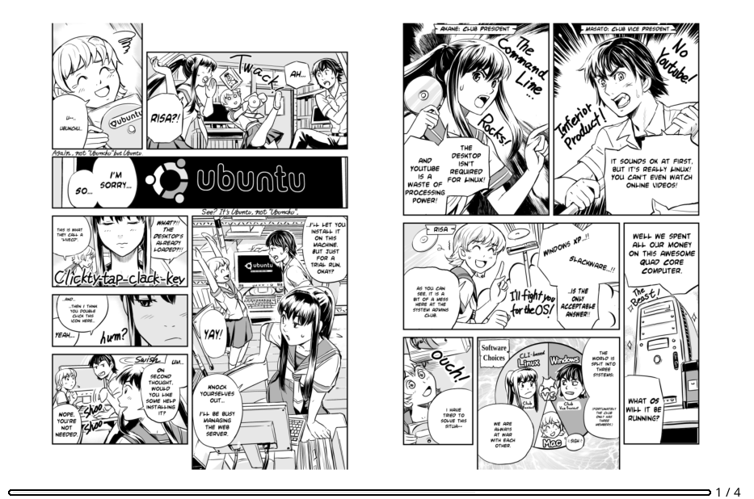
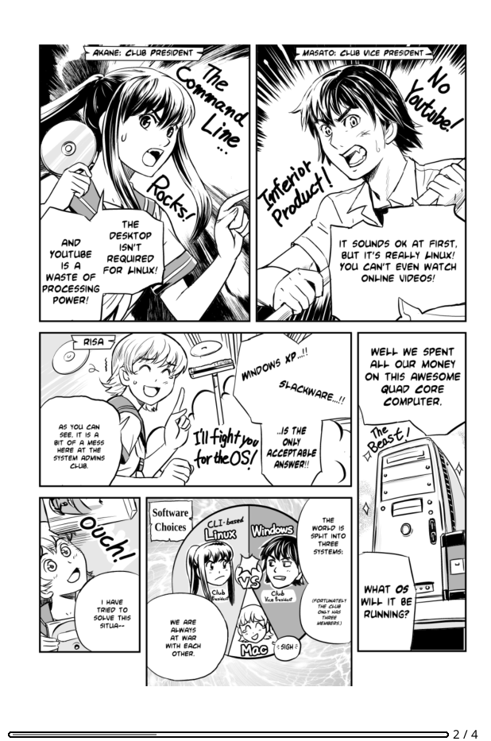
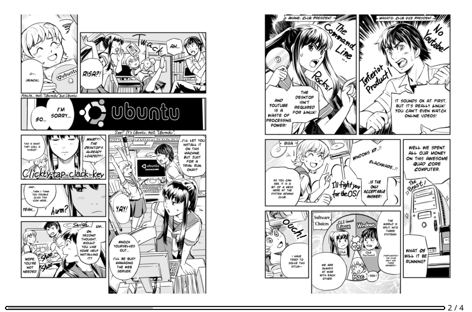
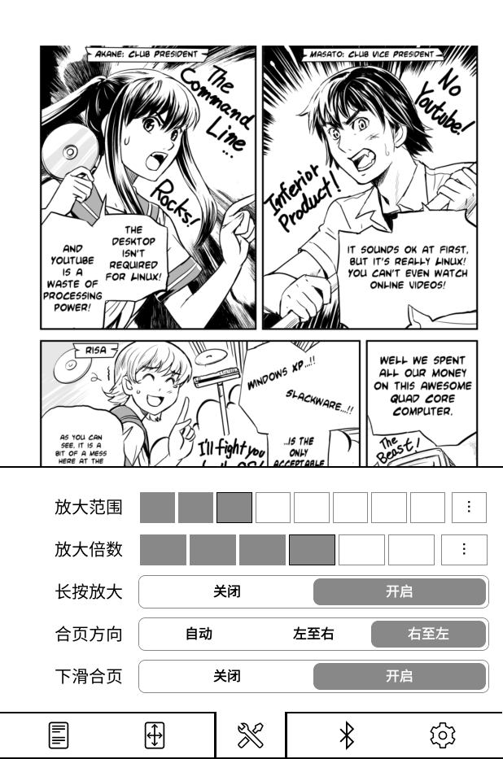
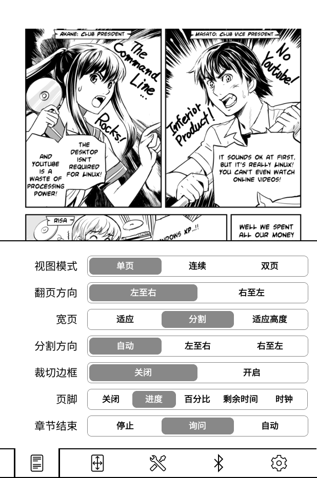
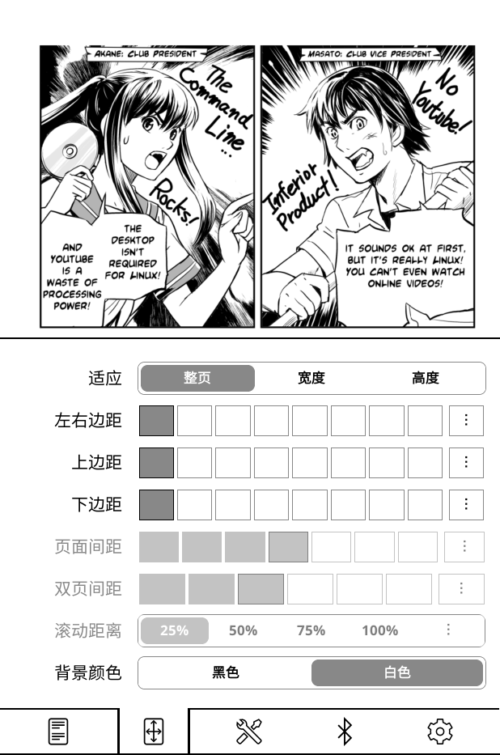
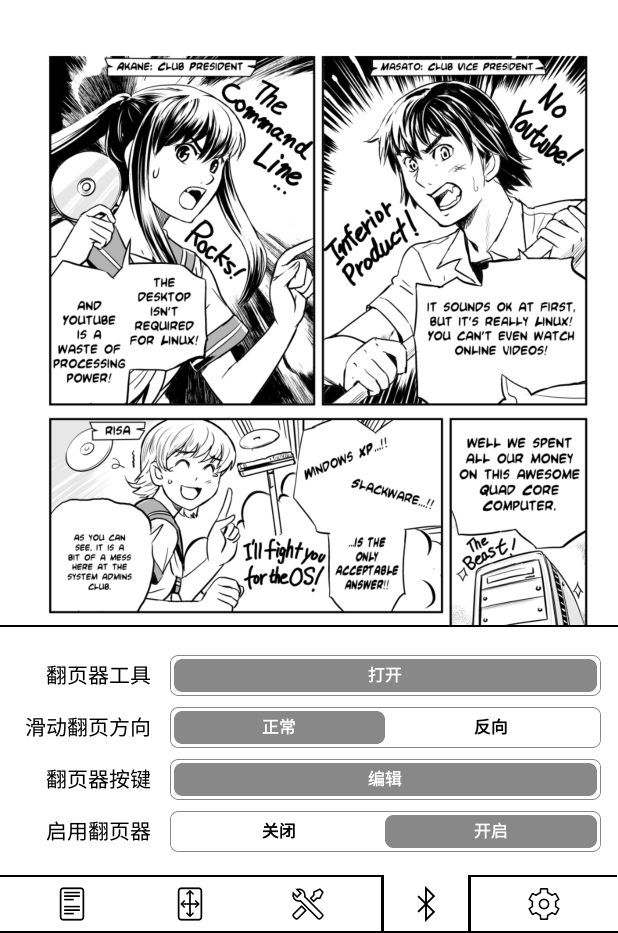
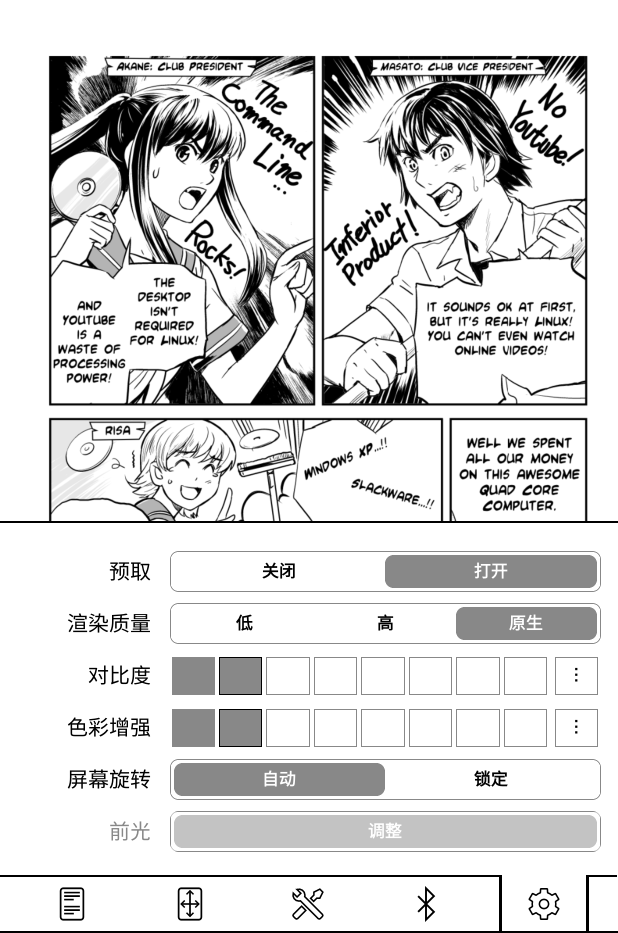
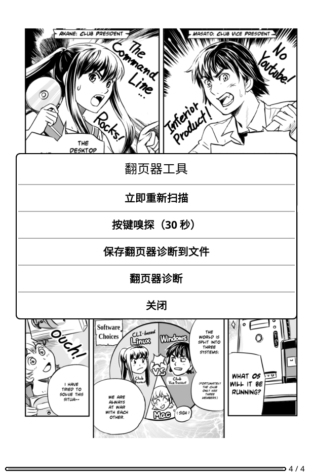

# Kamare（kamare.koplugin）

**Kamare** 是一个 [KOReader](https://github.com/koreader/koreader) 漫画阅读插件，直接连接自建的 [Kavita](https://github.com/Kareadita/Kavita) 服务器，不经过 OPDS。它自带漫画渲染器，支持长条（韩漫）、双页扫描、裁切边框、临时合页和蓝牙翻页器。

> 本项目基于 [fpammer/kamare.koplugin](https://github.com/fpammer/kamare.koplugin) 继续开发。

## 特性

- **直连 Kavita** —— 不用 OPDS，直接浏览书库、系列和章节。
- **三种阅读模式** —— 单页、连续滚动（长条）、双页。
- **下滑临时合页** —— 单页模式下向下滑，把本页和下一页合成一张跨页；再下滑退出，翻页自动跳过合过的两页。一次性操作，不改阅读模式。
- **宽页按书缝切分** —— 双页扫描的横图可以按真实书缝切成左右两半阅读；裁切边框后仍然正确。
- **裁切边框** —— 自动裁掉页面四周纯白/纯黑的边距（类似 Mihon）。
- **长按放大镜** —— 按住页面任意位置，出现跟手放大窗口，松手还原。
- **蓝牙翻页器** —— 自动接管翻页器节点；标准翻页键免配置，特殊按键可以自己指认；支持 Android 遥控器。
- **离线缓存** —— 整章下载为 cbz，断网可读，恢复连接后把进度推回 Kavita。
- **进度与统计** —— 同步 Kavita 阅读进度，同时接入 KOReader 阅读统计。
- **每系列独立设置** —— 全局默认 + 每系列覆盖，换书不串味。

## 截图

<p align="center">
  
  <br>
  <sub><b>下滑合页</b>：Split 横页的两个半页并回整张跨页；两半按裁切后的内容紧贴，排除中间书缝。</sub>
</p>

<table>
<tr>
<td align="center" valign="top" width="50%">

<br><b>单页阅读</b>
<br>按适应屏幕或原始比例显示
</td>
<td align="center" valign="top" width="50%">

<br><b>两张单页合页</b>
<br>合页方向为「右至左」，日漫第 5、6 页显示为左 6、右 5
</td>
</tr>
</table>

<p align="center">
  
  <br>
  <sub><b>操作 tab</b>：下滑合页开关、合页方向（自动 / 左至右 / 右至左）和长按放大。</sub>
</p>

<table>
<tr>
<td align="center" valign="top" width="50%">

<br><b>书库首页</b>
<br>On Deck、最近更新、想读
</td>
<td align="center" valign="top" width="50%">

<br><b>章节列表</b>
<br>查看章节与阅读进度
</td>
</tr>
</table>

## 下滑合页

在**单页模式**下，从屏幕任意位置向下滑动：

| 当前页 | 合页结果 |
| --- | --- |
| Split 横页的左半或右半 | 不管停在哪一半，都合回**同一张物理页**；两个半页紧贴，书缝被排除 |
| 普通竖页 | 本页 + **数值下一页**（第 5 页 → 5+6，第 6 页 → 6+7） |

- **合页方向**只影响两张独立页的左右摆放：`自动` 跟随「翻页方向」，`左至右` / `右至左` 可以单独覆盖。日漫第 5、6 页设为「右至左」后显示为**左 6、右 5**；Split 的两半永远按物理左右摆放，不受影响。
- **退出**：再下滑一次退出并停在当前页；按「下一页」会跳过整个合页对（5+6 → 7），按「上一页」到 4。
- **一次性**：不写任何持久设置，不切换 `view_mode`，不改变双页模式。
- **失败不动**：整张横图（`Wide Page = Fit`，本身已是完整跨页）、长条页、最后一页、下一页不是普通竖页时，下滑只写日志，不翻页。
- 合页显示期间长按放大镜会暂时禁用；切章、关书、改视图模式/裁切/阅读方向时合页自动清空。

## 阅读模式

<table>
<tr>
<td align="center" valign="top">

<br><b>单页</b>
<br>经典的单页阅读
</td>
<td align="center" valign="top">

<br><b>连续滚动</b>
<br>适合条漫和长条格式
</td>
<td align="center" valign="top">

<br><b>双页</b>
<br>横屏或宽屏下更像实体书
</td>
</tr>
</table>

- **宽页**：`适应` 把整张横图缩小显示；`分割` 按书缝切成左右两个逻辑页，可以逐半阅读；`适应高度` 放大到填满屏幕高度，左右拖动查看（仅单页模式）。
- **分割方向**：`自动` 跟随翻页方向；也可以强制 `左至右` / `右至左`，用来处理装订方向相反的书。
- **双页模式 vs 临时合页**：双页模式是持久阅读模式，按奇偶自动配对；临时合页是一次性的手动指定，会把裁切后的内容并在一起，翻页后立即退出，不会改变任何设置。

## 安装与 Kavita 设置

1. 从 [Releases](https://github.com/backtracker/kamare.koplugin/releases/latest) 下载最新的 `kamare.koplugin.zip`。
2. 解压后把 `kamare.koplugin` 文件夹放到 KOReader 的 `plugins/` 目录。
3. 重启 KOReader。
4. 从 KOReader 菜单（🔍）打开 Kamare，点左上角菜单 → **添加 Kavita 服务器**。
5. 填写服务器名称、URL（带协议，例如 `https://kavita.example.com`）和 API Key。

<p align="center">
  
</p>

### 获取 Kavita API Key

1. 登录 Kavita 网页端。
2. 进入 **Settings → Account → API Key**。
3. 如果没有 key，生成一个，然后粘贴到 Kamare 的添加服务器对话框。

已在 Kindle Paperwhite（第 2 代）和 Kobo Libra Colour 上测试。

## 离线缓存

Kamare 可以把整个 Kavita 章节下载成一个 cbz，断网阅读，并在恢复连接后把阅读位置推回 Kavita。

- **下载**：在系列页长按章节/卷，或用左上角菜单整系列下载（整系列、只下未读、从当前章节开始、接下来 N 卷）。
- **队列**：整个插件只有一个串行下载队列，支持进度、暂停/继续/重试；默认仅 Wi-Fi；空间不足时暂停而不是失败；重启后保留，不会自动开始。
- **离线书架**：没有网络时直接进入已缓存书架；未缓存的章节会显示但不可点。缓存章节从磁盘打开，零图片请求。
- **阅读日志**：位置保存在 `settings/kamare-journal.json`，不会跟缓存一起删除；重连后按单调规则推送（只有比服务器更靠前的位置才推）。
- **缓存管理**：左上角菜单 → **已缓存章节**，可以查看占用、排序、删除已读、更新过期章节、清空缓存、设置容量上限。
- **缓存位置**：`kamare/cache/<serverKey>/`；`serverKey` 在 URL/名称修改和 API Key 轮换后保持不变，不会让已有下载变成孤儿。

## 蓝牙翻页器

蓝牙翻页器（常见于手机遥控器/短视频遥控器）在系统里就是一个普通的 evdev 键盘。KOReader 在纯触屏设备上通常不会打开这个节点，Kamare 会找到它、打开它，并把键码教给 KOReader。

- **标准翻页键免配置**：KOReader 已经认得的 `LPgFwd` / `LPgBack`（PageUp/PageDown、音量键、方向键）直接翻页；Kamare 只补上阅读页收不到按键时缺失的那条路。
- **特殊按键自己指认**：长按阅读页**顶部 8%** → 蓝牙 tab → **翻页器按键**：
  - 「按两下设置」先按下一页键，再按上一页键；同一个键不能同时绑两个动作；
  - 下面两行显示当前键码，可以逐个添加/删除；
  - 每个动作最多 8 个键码；**恢复默认**会回到 `104` / `109`；
  - 绑定按设备保存在 `G_reader_settings`。
- **所有阅读模式可用**：单页、双页、连续滚动都能翻页。
- **只在 Kamare 阅读页生效**：阅读页在最上层时按键才会被吃掉；菜单/对话框打开时按键交给对话框。月读自己的「物理翻页键」设置是另一套，不受影响。
- **Android**：没有 `/dev/input` 节点，键码由系统直接送进 KOReader；Kamare 在输入后端和键盘处理器各观察一次（同一个键只处理一次）。KOReader 的 Android 桥会把媒体键、耳机键、静音键和部分音量键还给系统，Kamare 在绑定期间从 `AInputQueue_finishEvent` 接管它们；绑定完成后只接管真正绑过的码，以及语义明确的上一首/下一首（87/88）。电源键永远不会被接管。
- **单击像手指拖动的遥控器**：有些遥控器（以及相机式遥控器的环形键）短按不发键码，而是发一条短指针拖动。Kamare 阅读页注册了全屏 swipe：左右滑翻页；单页/双页模式下**下滑合页**、上滑上一页。方向反了就在蓝牙 tab 里把 **滑动翻页方向** 改成「反向」。
- **诊断**：蓝牙 tab → **翻页器工具**：
  - 立即重新扫描；
  - 按键嗅探（30 秒）——临时打开所有输入节点，找出「按了但没反应」的键；
  - 保存诊断到 `koreader/kamare-pager.log`；
  - 打开实时诊断页：状态、后端、当前绑定、最近按键、最近 swipe，以及每个输入节点声明的全部键码。
- **连接不是 Kamare 的事**：Kindle 上用 [kindle-hid-passthrough](https://github.com/zampierilucas/kindle-hid-passthrough) 把 BLE 遥控器变成虚拟键盘（如果已安装但没运行，Kamare 会尝试启动它）；Kobo 用系统蓝牙配对，Kamare 接管 `uhid` 节点（Kobo 路径尚未在真机上完整验证）。
- **与 `pageturner.koplugin` 共存**：两者可以同时安装；谁先拿到设备，只有真正绑定按键的插件会吞键；Kamare 也会处理 pageturner 广播的 `GotoViewRel`，不会翻两次。
- **不覆盖**：KOReader 原生 EPUB/PDF 阅读器，以及按住连续滚动。

## 设置

阅读时点屏幕下方打开阅读设置，5 个 tab：

| Tab | 内容 |
| --- | --- |
| **阅读** | 视图模式、翻页方向、宽页、分割方向、裁切边框、页脚、章节结束 |
| **版面** | 适应、左右边距、上边距、下边距、页面间距、双页间距、滚动距离、背景颜色 |
| **操作** | 放大范围、放大倍数、长按放大、合页方向、下滑合页 |
| **蓝牙** | 翻页器工具、滑动翻页方向、翻页器按键、启用翻页器 |
| **设置** | 预取、渲染质量、对比度、色彩增强、屏幕旋转、前光 |

- **每系列记忆**：改过一次设置后，再打开这个系列的任何章节都会恢复该系列的配置；没改过的系列继续跟随全局默认。每系列的值保存在 `settings/kamare_books.lua`，删掉对应条目或整个文件即可回到全局默认。
- **顶部 8% 长按**：直接打开蓝牙 tab，不依赖 Kamare 书库，在月读里打开的书也能用。

<details>
<summary><b>查看全部设置页截图</b></summary>

<table>
<tr>
<td align="center" valign="top"><br><b>阅读</b></td>
<td align="center" valign="top"><br><b>版面</b></td>
<td align="center" valign="top"><br><b>操作</b></td>
</tr>
<tr>
<td align="center" valign="top"><br><b>蓝牙</b></td>
<td align="center" valign="top"><br><b>设置</b></td>
<td align="center" valign="top"><br><b>翻页器工具</b></td>
</tr>
</table>

</details>

## 最近更新

### 0.10.12

- **裁切边框修好水印页的右侧白边**：1px 版面框线降采样后会变成一条灰线，和浅灰水印一起被当成「右边还有内容」，整圈白边就不裁。稀疏判定现在跳过紧贴强边界的这一行/列（四边对称），bilibili 水印页也能裁到版面框。
- **只裁浅灰，不碰墨迹**：49 页真实扫描件回归，多裁掉的区域里没有 `<160` 的墨迹像素，只有 ≥162 的水印浅灰；墨迹本来顶到页边的页面仍然不裁。

### 0.10.11

- **下滑临时合页**：单页模式下向下滑，把本页和下一页合在一起；再下滑退出，翻下一页自动跳过（5+6 → 7）。Split 横页合回整张物理页，两半按裁切后内容紧贴。
- **合页方向**：自动 / 左至右 / 右至左；日漫可以显示为左 6、右 5。Split 两半不受影响。
- **设置菜单重排为 5 个 tab**：阅读 / 版面 / 操作 / 蓝牙 / 设置。
- **蓝牙诊断动作**收进「翻页器工具」对话框。

### 0.10.10

- **翻页器设置并入阅读菜单**：蓝牙 tab，含启停、按键绑定、滑动方向、诊断、嗅探、重扫；长按顶部 8% 直接打开这个 tab。

### 0.10.9

- **双页扫描按真实书缝切分**：宽页四边内容顶满、找不到可裁外边框时，仍会从主色推断纸色并找到中间书缝，两半不再各留半条白边；不对称跨页也覆盖。

### 0.10.8

- **放大镜范围与倍数可调**：范围 10–70%（默认 25%），倍数 1.25–2.5x（默认 2x）。

### 0.10.7

- **长按放大镜**：按住页面任意位置出现跟手放大窗口，松手还原；可在阅读设置里开关。

### 0.10

- **离线缓存**：整章下载、断点续传、串行队列、离线书架、阅读日志、缓存管理、稳定 serverKey。
- **公开缓存 API**：`require("kamarecache")` 暴露 `API_VERSION = 1` 和 `capabilities`，月读（Moon）的 Kavita 源可以直接下载/检查/打开缓存章节。

## 开发与测试

```sh
./spec/run.sh            # 跑全部测试
./spec/run.sh queue      # 只跑文件名包含 queue 的测试
```

测试跑在 KOReader 模拟器的 LuaJIT 运行时（`v2026.07.2-207`）里，使用真实的 `rapidjson`、`libarchive` 和 `lfs`，不需要网络。默认运行时路径不存在时，用 `KOREADER_DIR` 指向包含 `luajit` 和 `common/` 的 KOReader 目录：

```sh
KOREADER_DIR=/path/to/koreader ./spec/run.sh
```

发布工作流会把 tag 版本注入 `kamareversion.lua`；普通 checkout 会显示 `0.10.12-dev`。

<details>
<summary><b>缓存 API 与插件接口</b></summary>

- **缓存 API**：`require("kamarecache")`，`API_VERSION = 1`，`capabilities = { status, summary, enqueue, delete, server, resume, queue, queue_control, index, open, estimate, chapters, delete_all }`。调用方用 `pcall(require, "kamarecache")` 探测；缺模块、major 不匹配或缺某个能力时静默降级。
- **失败约定**：`nil, code, message`，`code` 是 snake_case（`unknown_server`、`offline_not_cached`、`viewer_running`、`chapter_open`、`not_enough_space` 等）。
- **翻页器 API**：`require("kamarepager")` 暴露 `api_version`、`capabilities`、`status()`、`on()` / `off()`、`bindings()`。
- **功能清单**：`kamarefeatures.lua` 列出月读缓存页展示的功能；ID 由 Kamare 自己解释，`api_version` 只在清单结构变化时递增。

</details>

## 已知限制

- 只处理 Kamare 自己的漫画阅读页，不处理 KOReader 原生的 EPUB/PDF 阅读器。
- 合页只在单页模式生效；双页模式、连续滚动不支持。整张横图、长条页、最后一页会拒绝合页。
- 蓝牙翻页器的 Kobo 路径尚未在真机上完整验证。
- Android 上部分媒体键会被系统桥接层拦截；需要在绑定期间由 Kamare 接管（见上文）。

## 许可

本项目使用 [GNU Affero General Public License v3.0](LICENSE)。原项目由 [Fabian Pammer](https://github.com/fpammer) 创建。
